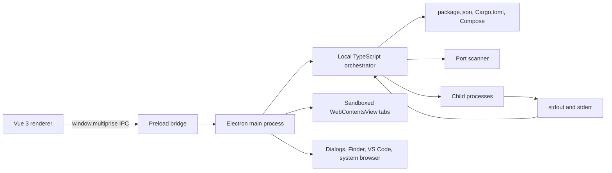

# multiprise

Multiprise is a macOS desktop control center for developers who run several local projects at once. It tracks projects, launches their services, assigns collision-free ports, captures logs, shows process ownership, and opens running apps in either the system browser or a tabbed in-app browser.

The name comes from the French word for a power strip: one place where many projects can be plugged in, observed, and unplugged.

> Current release: `v0.1.0` for Apple Silicon macOS. The build is not yet signed or notarized for public distribution.

## Why It Exists

A normal multi-project development session quickly turns into terminal management:

- remember which command starts each service;
- avoid reusing ports such as `3000`, `5000`, or `5173`;
- keep backend and frontend environment variables in sync;
- find the terminal that owns a process when something must stop;
- search through several streams of logs;
- reopen the correct local URL after a restart.

Multiprise turns that repeated setup into project discovery. A project is the parent folder selected by the user, and its existing manifests describe the services inside it.

## How It Was Made

### 1. Prove the workflow with a web prototype

The first version was called VibeManager. It used a Vue frontend and a Rust/Axum backend. That prototype established the core product model:

- track parent project folders;
- detect frontend and backend services;
- start and stop services independently or together;
- find available ports;
- stream and filter logs;
- inspect running processes;
- distinguish Multiprise-managed processes from external instances.

It also exposed the central constraint: this is a local operating-system tool, not a conventional web application. It needs filesystem access, child-process control, native dialogs, external URL handling, and persistent local state.

### 2. Rebuild it as an Electron application

The Rust server was retired and the application was rebuilt around Electron. The current stack is:

- **Electron** for the macOS window, native dialogs, child windows, embedded browser views, and OS integration;
- **TypeScript + Express** for local orchestration and project APIs;
- **Vue 3 Composition API** for the renderer;
- **Tailwind CSS** for the interface;
- **Vite** for renderer development and production builds;
- **electron-builder** for the `.app`, `.dmg`, and `.zip` artifacts.

Nuxt was intentionally left out. Multiprise does not need server-side rendering, routing conventions, or another runtime layer inside Electron.

### 3. Make project manifests the source of truth

An early version required a root-level `multiprise.json`. That created a second list of commands which could drift away from the real project. The requirement was removed after exactly that failure occurred: a backend supported `npm start`, while its stale Multiprise config still requested a nonexistent `npm run dev`.

Multiprise now discovers services directly from files the project already owns:

- `package.json` scripts for npm, pnpm, Yarn, and Bun projects;
- `Cargo.toml` for Rust services;
- `docker-compose.yml`, `docker-compose.yaml`, `compose.yml`, or `compose.yaml` for optional Docker services.

For JavaScript services, Multiprise scores scripts that actually exist. `dev` and `start:dev` are strongly preferred, followed by `develop`, `watch`, and `serve`; `start` is a production fallback and `preview` is last. Commands containing production signals such as `node dist/`, `next start`, or `NODE_ENV=production` are penalized. An npm `start` script is launched as `npm start`; other npm scripts use `npm run <script>`. A command edited by the user becomes user-owned and is never overwritten by a rescan; automatic commands continue following the manifest.

When a selected parent folder contains runnable child services, Multiprise ignores a root orchestration script to avoid launching the same backend and frontend twice. Docker Compose is detected separately and remains manual.

Port configuration stays portable through small framework adapters. Multiprise injects conventional variables such as `PORT`, `BACKEND_PORT`, `FRONTEND_PORT`, `API_PORT`, and frontend API values. Vite additionally receives an explicit `--port <port> --host 127.0.0.1` argument, while Nuxt and supported Cargo frameworks receive their conventional port variables.

See [`PROJECT_DISCOVERY.md`](./PROJECT_DISCOVERY.md) for the complete discovery rules.

### 4. Build collision-free port assignment

When automatic assignment is enabled, Multiprise scans the relevant range, rejects ports already owned by another listener, reserves an available port, and injects it into the service environment.

The current defaults live in [`port-ranges.json`](./port-ranges.json):

- frontend: `3000-4999` and `5100-5999`;
- backend: `5000-5099` and `8000-8999`.

The ranges deliberately avoid overlap. Manual mode is strict: the user must select a port, and launch fails clearly if that port is unavailable. Launching a whole project resolves backend and frontend ports together so both services receive `BACKEND_PORT`, `FRONTEND_PORT`, `PORT`, and inferred frontend API values consistently.

### 5. Add process ownership and reliable shutdown

Each launched service is stored with its project, command, command ownership, framework, port, PID, process group, and lifecycle state (`starting`, `ready`, `failed`, or `stopped`). Multiprise reads the machine's listening ports to show both managed and external processes.

This distinction matters. If a developer started a service in another terminal, Multiprise should report an external instance rather than pretending it launched that process. Managed processes can be stopped as a group so child watchers do not remain headless after the parent command exits.

Docker Compose definitions are shown separately and remain manually controlled. The project-level Launch action starts regular development services, not Docker services.

### 6. Turn process output into usable logs

Child-process `stdout` and `stderr` are captured by the TypeScript backend and sent to the renderer. Before display, Multiprise:

- removes terminal control sequences;
- handles progress-line rewrites produced by watch tools;
- suppresses repeated identical lines;
- associates every line with a project and service;
- classifies common error, warning, backend, and frontend output;
- keeps the log view pinned to the newest output unless the user scrolls away.

The result is a searchable terminal-style log surface without the unreadable escape codes commonly produced by development servers.

Packaged macOS apps opened from Finder do not inherit the terminal's `PATH`. Before the backend loads, Electron now imports the user's interactive login-shell path so npm, pnpm, Bun, Cargo, and other shell-installed runtimes remain available. Every command is preflighted before spawn, turning a missing runtime into an immediate actionable error instead of a silent or repeated shell failure.

### 7. Design the renderer around the working session

The interface went through several layouts before settling on three priorities:

1. **Logs** are the main surface because they explain what a project is doing.
2. **Services** provide compact launch, stop, URL, and port controls.
3. **Processes** expose ownership and PIDs when deeper inspection is needed.

The sidebar holds project search, tracked projects, active ports, and settings. Project rows show a small live state without repeating status labels. The home state focuses on adding or reopening projects, and every application launch starts there rather than restoring an accidental modal or detail view.

The UI uses rounded, calm surfaces, an optional light or dark appearance, restrained animation, and a small electrical metaphor rather than turning every control into a plug or glowing status indicator.

### 8. Add a tabbed in-app browser

Running frontends can open in the system browser or inside Multiprise. The embedded browser uses Electron `WebContentsView` instances managed by the main process. The Vue renderer supplies tab controls for:

- multiple local pages;
- back and forward navigation;
- reload;
- address changes;
- opening the current page externally;
- docked DevTools.

Embedded pages are sandboxed, context-isolated, and restricted to HTTP(S) navigation. This preserves the convenience of an integrated preview without giving project pages access to Multiprise's privileged bridge.

### 9. Package state correctly for macOS

Development data can live beside the source tree, but a packaged Electron application is stored in a read-only archive. The production build therefore points the backend at Electron's application-support directory before loading it.

Local state is stored under:

```text
~/Library/Application Support/Multiprise/data/
```

That directory contains tracked projects and settings. It is intentionally excluded from Git and from release artifacts.

The first packaged smoke test caught an important ordering bug: the backend module was imported before its writable data directory was configured, causing it to target the read-only application archive. Backend loading is now deferred until Electron has established `MULTIPRISE_DATA_DIR`.

### 10. Publish the first release

The source was cleaned of local state, generated builds, environment files, and retired prototype code before publication. `electron-builder` produces an Apple Silicon application bundle, DMG installer, and ZIP archive. Version `v0.1.0` is published as a private GitHub release while signing, notarization, and wider platform support are still pending.

## Architecture



The renderer never receives unrestricted Node.js access. Privileged operations cross the narrow bridge in [`preload.cjs`](./preload.cjs), while Electron lifecycle and native integration live in [`main.cjs`](./main.cjs).

## Launch Flow

When a user launches a project, Multiprise performs this sequence:

1. Scan the selected project root and score runnable manifest scripts.
2. Separate regular services from manually controlled Docker services.
3. Resolve the user-owned or automatically detected command.
4. Honor `package.json#packageManager`, then fall back to lockfile detection.
5. Install missing dependencies when automatic preparation is enabled.
6. Build a missing `dist`, `build`, `.next`, or `.output` startup target once when a build script is available.
7. Allocate or strictly validate one port per regular service.
8. Start support services, then backend services, wait for readiness, and only then start frontend services.
9. Mark a service ready only after its assigned port accepts connections; early exits and timeouts remain visible as failed states with final logs.
10. Keep healthy services alive when another stage fails and report partial readiness such as `1/2 ready`.

## Project Structure

```text
multiprise/
├── backend/
│   ├── src/
│   │   ├── server.ts            # Express routes and orchestration API
│   │   ├── scanner.ts           # Project and runtime discovery
│   │   ├── processes.ts         # Starting/ready/failed lifecycle and logs
│   │   ├── preparation.ts       # Dependency install and missing-build preparation
│   │   ├── failures.ts          # Actionable startup error classification
│   │   ├── ports.ts             # Port inspection and allocation
│   │   ├── store.ts             # Persistent project/settings storage
│   └── tsconfig.json
├── renderer/
│   ├── src/App.vue              # Main Vue application
│   ├── src/style.css            # Tailwind layers and theme tokens
│   └── vite.config.js
├── backend/test/                # Fixture-driven reliability regressions
├── .github/workflows/ci.yml     # Build and reliability checks
├── scripts/dev.mjs              # Portable development launcher
├── main.cjs                     # Electron main process
├── preload.cjs                  # Context-isolated renderer bridge
├── port-ranges.json             # Automatic allocation ranges
├── PROJECT_DISCOVERY.md         # Manifest discovery rules
└── package.json                 # Development, build, and package scripts
```

## Supported Projects

Multiprise can discover common project layouts and commands for:

- npm;
- pnpm;
- Yarn;
- Bun;
- Rust/Cargo;
- Docker Compose.

The detected manifest is the source of truth until a user edits a service command. Automatic commands refresh from disk; user-owned commands persist across rescans until reset to Auto.


## Reliability Tests

Run the launch-pipeline regression suite with:

```bash
npm run test:backend
```

The tests cover development-script scoring, `packageManager` precedence, Vite port flags, missing-build preparation, delayed readiness, early exits, actionable error classification, command ownership, and discovery fixtures for Vue/Vite, React/Vite, Next.js, NestJS, pnpm/Turbo, Yarn/Nx, Bun, Cargo, and Docker Compose. GitHub Actions runs this suite plus the renderer production build on every push and pull request.

## Run From Source

### Requirements

- macOS;
- Node.js 20 or newer;
- npm;
- the runtimes required by the projects you plan to launch.

### Install and launch

```bash
npm install
npm run dev
```

The development launcher starts the local TypeScript orchestrator, Vite renderer, and Electron shell together. It picks free internal ports automatically.

Explicit development ports are also supported:

```bash
npm run dev -- --backend-port 4000 --frontend-port 5174
```

Explicit ports are strict. The command exits with a clear error if either requested port is unavailable or both values are the same.

### Run individual development surfaces

```bash
npm run dev:api
npm run dev:web
npm run dev:electron
```

The combined `npm run dev` command is recommended because it coordinates startup order and environment variables.

## Build and Package

Build the TypeScript backend and Vue renderer:

```bash
npm run build:api
npm run build:web
```

Create the macOS app, DMG, and ZIP:

```bash
npm run package:mac
```

Artifacts are written to `release/`. The current package target is Apple Silicon (`arm64`).

## Security and Privacy

- Multiprise is local-first; tracked project data is stored on the machine.
- The orchestration server binds to `127.0.0.1`, not the public network interface.
- The renderer uses context isolation instead of direct Node.js access.
- Embedded browser pages are sandboxed and limited to HTTP(S).
- Personal project paths, settings, logs, and generated release files are excluded from Git.
- Project manifest scripts are trusted local instructions. Review an unfamiliar repository's scripts before launching it.

## Current Limitations

- The packaged release currently targets Apple Silicon macOS only.
- The app is not signed or notarized, so macOS may require an explicit first-open approval.
- Windows and Linux packaging have not been implemented.
- Resource graphs and historical metrics are not part of the first release.

## Lessons From the Build

- A local orchestration tool benefits from a desktop shell more than a browser-first architecture.
- Reading existing manifests avoids stale duplicate configuration, while environment injection remains more portable than rewriting project code.
- Port ownership and process ownership are different facts and must be modeled separately.
- Stopping a command is not enough when development tools create child watchers; process groups matter.
- Packaged Electron apps need an explicit writable data path established before backend initialization.
- Logs are the highest-value surface, so visual hierarchy should favor them over dashboards and decorative statistics.
- Product features should earn their complexity: an early workspace abstraction was removed when direct project launch proved simpler.

## Roadmap

Future work is tracked in [`upcoming-features.md`](./upcoming-features.md). Likely next steps include signed releases, additional operating systems, richer runtime support, and deeper browser/session controls.

## License

No open-source license has been selected yet. Until one is added, the source remains copyright-protected by default.
