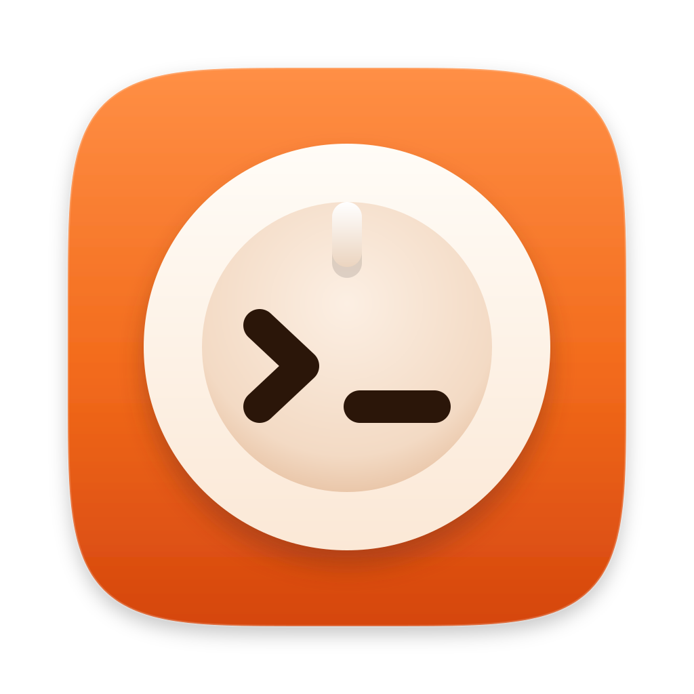
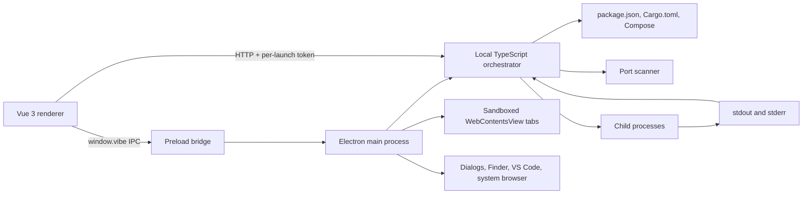

<p align="center">
  
</p>
<h1 align="center">multiprise</h1>

Multiprise is a macOS desktop control center for developers who run several local projects at once. It tracks projects, launches their services, assigns collision-free ports, captures logs, shows process ownership, and opens running apps in either the system browser or a tabbed in-app browser.

The name comes from the French word for a power strip: one place where many projects can be plugged in, observed, and unplugged.

> Current release: `v0.1.0` for Apple Silicon macOS. The build is not yet signed or notarized, so the first launch needs one extra approval step (see below).

## Install

**Requirements:** a Mac with Apple Silicon (M1 or newer) running macOS 12 Monterey or later, plus the runtimes your own projects need (Node.js, Cargo, Docker, …).

1. Download `Multiprise-<version>-arm64.dmg` from the [Releases](https://github.com/Djbrl/multiprise/releases) page.
2. Open the DMG and drag **Multiprise** into **Applications**.
3. Open Multiprise from Applications. Because the app is not notarized yet, macOS blocks the first launch:
   - open **System Settings → Privacy & Security**, scroll to the message about Multiprise, and click **Open Anyway**; then confirm with your password or Touch ID. (Since macOS 15, right-click → Open no longer bypasses this.)
   - or, from Terminal, remove the download quarantine flag:

     ```bash
     xattr -dr com.apple.quarantine /Applications/Multiprise.app
     ```

After that first approval, Multiprise opens normally. Your tracked projects and settings live in `~/Library/Application Support/Multiprise/data/`.

## Command Line and MCP Server

Multiprise also works from a terminal and from coding agents. Choose **Install Command Line Tool…** in the menu bar menu to link `multiprise` into `/usr/local/bin`. It runs on the Node runtime built into the app, so Node.js does not need to be installed.

```bash
multiprise ls                  # every project and service, with status and URL
multiprise up                  # start the project containing this folder, backend first
multiprise up shop/api         # or name a project, a service, project/service, or a folder
multiprise logs web -f         # follow a service's output
multiprise url web             # print its URL, e.g. open "$(multiprise url web)"
multiprise restart api
multiprise down
```

`up` and `restart` wait until each service accepts connections, give it the same port it had last time when that port is free, and hand `BACKEND_PORT`/`FRONTEND_PORT` to its siblings, exactly like the app's buttons. `ls`, `up`, `down`, `restart` and `url` accept `--json`. The CLI talks to the running app and opens it if needed.

`multiprise mcp` runs a [Model Context Protocol](https://modelcontextprotocol.io) server over stdio, so coding agents reuse the services you already run instead of starting duplicates on random ports. It provides `list_services`, `start_service`, `stop_service`, `restart_service`, `tail_logs` and `get_url`. For Claude Code:

```bash
claude mcp add multiprise -- multiprise mcp
```

Other clients take the usual configuration:

```json
{ "mcpServers": { "multiprise": { "command": "multiprise", "args": ["mcp"] } } }
```

From a source checkout, run the CLI with `npm run cli -- <command>` (names only; it runs from the repository folder), or `npm run build:api && npm link` for a `multiprise` command.

## Stable Hostnames

Every service is also served at a name that never changes, whatever port it holds: `http://<service>.<project>.localhost:7331`, for example `http://web.shop.localhost:7331`. A service named like its project gets the project's name (`http://blog.localhost:7331`), and a project's own name leads to its frontend. Browsers, curl and Node resolve `*.localhost` to this machine without any DNS setup.

The names come from a small reverse proxy inside Multiprise that listens on the loopback addresses only. It passes the original `Host` header through (Vite and Next.js accept `*.localhost`), adds `X-Forwarded-Host`, and tunnels WebSockets, so hot reload keeps working. A stopped service answers with a page explaining how to start it; `http://localhost:7331` lists every name. `multiprise ls`, the MCP tools and the menu bar's **Copy Stable URL** show them.

Both are in **Settings → Stable hostnames** (the `proxy_port` and `hostnames` settings), and changes apply as soon as they are saved. If the port is taken when Multiprise starts, the proxy stays off, services keep working on their own ports, and `/api/hostnames` reports why.

## Service Links and Environment

Each service's **Environment…** button (in its details) edits the variables it starts with and the services it depends on.

- **Variables** are added to what Multiprise sets itself (`PORT`, `BACKEND_PORT`, `FRONTEND_PORT`, …) and win over it, except `PORT`. A value can point at another service: `{{services.api.url}}`, `{{services.api.port}}` or `{{services.api.host_url}}`, where `api` is a service in the same project, `project/service`, or a service id.
- **Secrets** are stored encrypted in `secrets.json` with a key held in the macOS Keychain (Electron `safeStorage`), are never shown again, and never reach `projects.json` or the API.
- **Depends on** lists services that start first whenever this one starts, in dependency order, with their own settings; loops are refused. Without links, the backend-before-frontend order and linked ports work as before.
- A **`.env.example`** (or `.env.sample`, `.env.template`) without a `.env` is flagged in the editor, with a button to add the missing variables, and in the service log when it starts.

## Why It Exists

A normal multi-project development session quickly turns into terminal management:

- remember which command starts each service;
- avoid reusing ports such as `3000`, `5000`, or `5173`;
- keep backend and frontend environment variables in sync;
- find the terminal that owns a process when something must stop;
- search through several streams of logs;
- reopen the correct local URL after a restart.

Multiprise turns that repeated setup into project discovery. A project is the parent folder selected by the user, and its existing manifests describe the services inside it.

## How It Was Made

### 1. Prove the workflow with a web prototype

The first version was called VibeManager. It used a Vue frontend and a Rust/Axum backend. That prototype established the core product model:

- track parent project folders;
- detect frontend and backend services;
- start and stop services independently or together;
- find available ports;
- stream and filter logs;
- inspect running processes;
- distinguish Multiprise-managed processes from external instances.

It also exposed the central constraint: this is a local operating-system tool, not a conventional web application. It needs filesystem access, child-process control, native dialogs, external URL handling, and persistent local state.

### 2. Rebuild it as an Electron application

The Rust server was retired and the application was rebuilt around Electron. The current stack is:

- **Electron** for the macOS window, native dialogs, child windows, embedded browser views, and OS integration;
- **TypeScript + Express** for local orchestration and project APIs;
- **Vue 3 Composition API** for the renderer;
- **Tailwind CSS** for the interface;
- **Vite** for renderer development and production builds;
- **electron-builder** for the `.app`, `.dmg`, and `.zip` artifacts.

Nuxt was intentionally left out. Multiprise does not need server-side rendering, routing conventions, or another runtime layer inside Electron.

### 3. Make project manifests the source of truth

An early version required a root-level `multiprise.json`. That created a second list of commands which could drift away from the real project. The requirement was removed after exactly that failure occurred: a backend supported `npm start`, while its stale Multiprise config still requested a nonexistent `npm run dev`.

Multiprise now discovers services directly from files the project already owns:

- `package.json` scripts for npm, pnpm, Yarn, and Bun projects;
- `Cargo.toml` for Rust services;
- `docker-compose.yml`, `docker-compose.yaml`, `compose.yml`, or `compose.yaml` for optional Docker services.

For JavaScript services, Multiprise scores scripts that actually exist. `dev` and `start:dev` are strongly preferred, followed by `develop`, `watch`, and `serve`; `start` is a production fallback and `preview` is last. Commands containing production signals such as `node dist/`, `next start`, or `NODE_ENV=production` are penalized. An npm `start` script is launched as `npm start`; other npm scripts use `npm run <script>`. A command edited by the user becomes user-owned and is never overwritten by a rescan; automatic commands continue following the manifest.

When a selected parent folder contains runnable child services, Multiprise ignores a root orchestration script to avoid launching the same backend and frontend twice. Docker Compose is detected separately and remains manual.

Port configuration stays portable through small framework adapters. Multiprise injects conventional variables such as `PORT`, `BACKEND_PORT`, `FRONTEND_PORT`, `API_PORT`, and frontend API values. Vite additionally receives an explicit `--port <port> --host 127.0.0.1` argument, while Nuxt and supported Cargo frameworks receive their conventional port variables.

See [`PROJECT_DISCOVERY.md`](./PROJECT_DISCOVERY.md) for the complete discovery rules.

### 4. Build collision-free port assignment

When automatic assignment is enabled, Multiprise scans the relevant range, rejects ports already owned by another listener, reserves an available port, and injects it into the service environment.

The current defaults live in [`port-ranges.json`](./port-ranges.json):

- frontend: `3000-4999` and `5100-5999`;
- backend: `5000-5099` and `8000-8999`.

A service keeps the port it had last time whenever that port is still free, so its URL — and any bookmark, OAuth callback, or CORS allowlist pointing at it — survives a relaunch. A new port is chosen only when the old one has been taken.

The ranges deliberately avoid overlap. Manual mode is strict: the user must select a port, and launch fails clearly if that port is unavailable. Launching a whole project resolves backend and frontend ports together so both services receive `BACKEND_PORT`, `FRONTEND_PORT`, `PORT`, and inferred frontend API values consistently.

### 5. Add process ownership and reliable shutdown

Each launched service is stored with its project, command, command ownership, framework, port, PID, process group, and lifecycle state (`starting`, `ready`, `failed`, or `stopped`). Multiprise reads the machine's listening ports to show both managed and external processes.

This distinction matters. If a developer started a service in another terminal, Multiprise should report an external instance rather than pretending it launched that process. Managed processes run in their own process group, so the real server started by `npm run dev` is recognised as part of the service, and stopping it also stops child watchers instead of leaving them headless.

Quitting Multiprise stops every service it launched, including dependency installs and builds still in progress, before the app exits. Docker Compose services are left running because they are managed by Docker; stop them from the project before quitting if you want them down.

Docker Compose definitions are shown separately and remain manually controlled. The project-level Launch action starts regular development services, not Docker services. Their status comes from `docker compose ps` every few seconds rather than from what Multiprise last did, so containers started or stopped in a terminal, left running while the app was closed, or crashing show up as they are: a container that exits with an error, keeps restarting, or fails its health check marks the service failed with the reason. The containers' output streams into the service log (`docker compose logs --follow`), and the service URL uses the first published port that is not a common database port.

Closing the window does not stop anything. A menu bar icon shows how many services are running and lets you start, stop, retry, or open each one without bringing the window back. When Multiprise is in the background, a notification reports a service that crashes or one that becomes ready after a slow start; both can be turned off in Settings.

### 6. Turn process output into usable logs

Child-process `stdout` and `stderr` are captured by the TypeScript backend and pushed to the renderer over a server-sent event stream as they are printed, together with status changes. Before display, Multiprise:

- removes terminal control sequences;
- handles progress-line rewrites produced by watch tools;
- collapses consecutive identical lines into one entry with a `×N` counter;
- associates every line with a project and service;
- classifies common error, warning, backend, and frontend output;
- keeps the log view pinned to the newest output unless the user scrolls away.

The result is a searchable terminal-style log surface without the unreadable escape codes commonly produced by development servers.

Each run is also written to disk, and the run before it is kept alongside, so the output of a crash is still there after a relaunch or after Multiprise itself restarts.

Packaged macOS apps opened from Finder do not inherit the terminal's `PATH`. Before the backend loads, Electron now imports the user's interactive login-shell path so npm, pnpm, Bun, Cargo, and other shell-installed runtimes remain available. Every command is preflighted before spawn, turning a missing runtime into an immediate actionable error instead of a silent or repeated shell failure.

### 7. Design the renderer around the working session

The interface went through several layouts before settling on three priorities:

1. **Logs** are the main surface because they explain what a project is doing.
2. **Services** provide compact launch, stop, URL, and port controls.
3. **Processes** expose ownership and PIDs when deeper inspection is needed.

The sidebar holds project search, tracked projects, active ports, and settings. Project rows show a small live state without repeating status labels. The home state focuses on adding or reopening projects, and every application launch starts there rather than restoring an accidental modal or detail view.

The UI uses rounded, calm surfaces, an optional light or dark appearance, restrained animation, and a small electrical metaphor rather than turning every control into a plug or glowing status indicator.

### 8. Add a tabbed in-app browser

Running frontends can open in the system browser or inside Multiprise. The embedded browser shares the project’s main focus panel with Logs, so switching between output and a live page does not leave the project workspace. Electron `WebContentsView` instances are managed by the main process while the Vue renderer supplies tab controls for:

- multiple local pages;
- back and forward navigation;
- reload;
- address changes;
- opening the current page externally;
- docked DevTools;
- detaching a live tab into its own controlled Multiprise window and attaching the same view back without reloading it.

Service URL actions use main-process IPC for reliable clipboard writes and system-browser opening from sandboxed renderer builds. Embedded pages are sandboxed, context-isolated, run in their own browser session, and restricted to HTTP(S) navigation. Permission requests from those pages — notifications, camera, geolocation, or launching other apps through custom URL schemes — are denied. This preserves the convenience of an integrated preview without giving project pages access to Multiprise's privileged bridge.

### 9. Package state correctly for macOS

Development data can live beside the source tree, but a packaged Electron application is stored in a read-only archive. The production build therefore points the backend at Electron's application-support directory before loading it.

Local state is stored under:

```text
~/Library/Application Support/Multiprise/data/
```

That directory contains tracked projects, settings, and a `logs/` folder with each service's latest and previous run. It is intentionally excluded from Git and from release artifacts.

The first packaged smoke test caught an important ordering bug: the backend module was imported before its writable data directory was configured, causing it to target the read-only application archive. Backend loading is now deferred until Electron has established `MULTIPRISE_DATA_DIR`.

### 10. Publish the first release

The source was cleaned of local state, generated builds, environment files, and retired prototype code before publication. `electron-builder` produces an Apple Silicon application bundle, DMG installer, and ZIP archive. Version `v0.1.0` is the first public release; signing, notarization, and wider platform support are still pending.

## Architecture



The renderer never receives unrestricted Node.js access. Privileged operations cross the narrow bridge in [`preload.cjs`](./preload.cjs), while Electron lifecycle and native integration live in [`main.cjs`](./main.cjs). The renderer talks to the orchestrator over loopback HTTP using a random token generated at every launch; only the main window can obtain it through the bridge.

## Launch Flow

When a user launches a project, Multiprise performs this sequence:

1. Scan the selected project root and score runnable manifest scripts.
2. Separate regular services from manually controlled Docker services.
3. Resolve the user-owned or automatically detected command.
4. Honor `package.json#packageManager`, then fall back to lockfile detection.
5. Install missing dependencies when automatic preparation is enabled.
6. Build a missing `dist`, `build`, `.next`, or `.output` startup target once when a build script is available.
7. Allocate or strictly validate one port per regular service.
8. Start support services, then backend services, wait for readiness, and only then start frontend services.
9. Mark a service ready only after its assigned port accepts connections (frontends must also answer HTTP with a non-5xx status); early exits and timeouts remain visible as failed states with final logs.
10. Keep healthy services alive when another stage fails and report partial readiness such as `1/2 ready`.

Once a service is ready, Multiprise keeps watching it:

- **Crashes are restarted.** A service that exits after it was ready is relaunched on the same port with the same command and environment, after 1 s, 5 s and 15 s, at most three times in ten minutes. The crash output stays in the log above the restart. Stopping the service cancels a pending restart; **Settings → Service supervision** turns this off.
- **Hangs are flagged, not killed.** Every 15 seconds a service that has answered HTTP must answer a request again (the probes identify themselves as `Multiprise health check`); services that never spoke HTTP only have to keep accepting connections. After two missed probes the service shows as failed with a "Not responding" message but keeps running, since it may be paused in a debugger, and it turns ready again as soon as it answers.

## Project Structure

```text
multiprise/
├── backend/
│   ├── src/
│   │   ├── index.ts             # Server startup, API token, and shutdown
│   │   ├── server.ts            # Express app assembly
│   │   ├── routes/              # API routes by area (projects, services, ports, …)
│   │   ├── launch.ts            # Starting and stopping a service
│   │   ├── guard.ts             # API token, origin, and host checks
│   │   ├── state.ts             # In-memory state and startup reconciliation
│   │   ├── scanner.ts           # Project and runtime discovery
│   │   ├── runtime.ts           # Node version resolution (.nvmrc, engines, fnm)
│   │   ├── processes.ts         # Starting/ready/failed lifecycle and logs
│   │   ├── supervisor.ts        # Health checks and crash restarts
│   │   ├── docker.ts            # Docker Compose status and log streaming
│   │   ├── hostnames.ts         # *.localhost reverse proxy
│   │   ├── environment.ts       # Service variables, secrets, templates, .env checks
│   │   ├── events.ts            # Status, log, and project change events
│   │   ├── logfiles.ts          # Per-run service log files on disk
│   │   ├── preparation.ts       # Dependency install and missing-build preparation
│   │   ├── failures.ts          # Actionable startup error classification
│   │   ├── ports.ts             # Port inspection and allocation
│   │   ├── store.ts             # Persistent project/settings storage
│   │   ├── discovery.ts         # Advertises the running API to the CLI (api.json)
│   │   ├── cli/                 # `multiprise` CLI and MCP server
│   └── tsconfig.json
├── renderer/
│   ├── src/App.vue              # Main Vue application
│   ├── src/components/          # Dialogs and panels split out of App.vue
│   ├── src/ui.ts                # Shared button, input, and panel classes
│   ├── src/style.css            # Tailwind layers and theme tokens
│   └── vite.config.js
├── backend/test/                # Fixture-driven reliability regressions
├── brand/                       # Logo and icon sources; see brand/README.md
├── .github/workflows/ci.yml     # Build and reliability checks
├── scripts/dev.mjs              # Portable development launcher
├── main.cjs                     # Electron main process
├── menu-bar.cjs                 # Menu bar icon and service notifications
├── cli-install.cjs              # "Install Command Line Tool…" (links bin/multiprise)
├── bin/multiprise               # CLI launcher shipped inside the app bundle
├── preload.cjs                  # Context-isolated renderer bridge
├── port-ranges.json             # Automatic allocation ranges
├── PROJECT_DISCOVERY.md         # Manifest discovery rules
└── package.json                 # Development, build, and package scripts
```

## Supported Projects

Multiprise can discover common project layouts and commands for:

- npm;
- pnpm;
- Yarn;
- Bun;
- Rust/Cargo;
- Docker Compose.

The detected manifest is the source of truth until a user edits a service command. Automatic commands refresh from disk; user-owned commands persist across rescans until reset to Auto.


## Reliability Tests

Run the launch-pipeline regression suite with:

```bash
npm run test:backend
```

The tests cover development-script scoring, `packageManager` precedence, Vite port flags, missing-build preparation, delayed readiness, early exits, actionable error classification, command ownership, and discovery fixtures for Vue/Vite, React/Vite, Next.js, NestJS, pnpm/Turbo, Yarn/Nx, Bun, Cargo, and Docker Compose. They also cover the API guard (token, origin, and host checks), malformed input, atomic state writes, concurrent launches, cancelling a launch during its build, stopping every service on shutdown, and Node `engines` ranges. Service links and environments are tested end to end: link validation and loops, dependencies starting first with their sibling ports, templates, secrets that are never returned or written to `projects.json`, invalid variables, `.env.example` warnings, and settings surviving a restart. The hostname proxy is tested end to end: naming rules, proxied requests with their headers, WebSocket upgrades, IPv6-only servers, error pages, foreign hosts, and a taken port. Docker Compose state is tested against a stand-in `docker` command: both `ps` output formats, container states, changes made outside the app, Docker becoming unavailable, and log streaming. Supervision is covered too: crash restarts on the same port, the restart limit, Stop cancelling a pending restart, and hang detection and recovery. The CLI and MCP server are tested end to end: name resolution, API discovery and stale discovery files, backend-first project launches with linked ports, and the MCP tool calls over stdio. GitHub Actions runs this suite plus the renderer production build on every push and pull request.

## Run From Source

### Requirements

- macOS;
- Node.js 20.19+ or 22.12+ (required by Vite 7);
- npm;
- the runtimes required by the projects you plan to launch.

### Install and launch

```bash
npm install
npm run dev
```

The development launcher starts the local TypeScript orchestrator, Vite renderer, and Electron shell together. It picks free internal ports automatically.

Explicit development ports are also supported:

```bash
npm run dev -- --backend-port 4000 --frontend-port 5174
```

Explicit ports are strict. The command exits with a clear error if either requested port is unavailable or both values are the same.

### Run individual development surfaces

```bash
npm run dev:api
npm run dev:web
npm run dev:electron
```

The combined `npm run dev` command is recommended because it coordinates startup order and environment variables. When running `npm run dev:api` on its own, the orchestrator prints its API token at startup; send it as the `x-multiprise-token` header (or set `MULTIPRISE_API_TOKEN` to choose one).

## Build and Package

Build the TypeScript backend and Vue renderer:

```bash
npm run build:api
npm run build:web
```

Create the macOS app, DMG, and ZIP:

```bash
npm run package:mac
```

Artifacts are written to `release/`. The current package target is Apple Silicon (`arm64`).

## Security and Privacy

- Multiprise is local-first; tracked project data is stored on the machine.
- The orchestration server binds to `127.0.0.1`, not the public network interface. The hostname proxy binds to `127.0.0.1` and `::1` only, routes only `*.localhost` names, and refuses other `Host` headers.
- Every API request must carry a random token generated at launch. It is handed to Multiprise's own window and written to `api.json` in the data folder, readable only by your user account, for the `multiprise` CLI and MCP server; the file is removed when the app quits. Requests from other browser origins or with a non-loopback `Host` header are rejected, so websites you visit cannot drive the local API (including via DNS rebinding).
- The renderer uses context isolation instead of direct Node.js access, cannot navigate away from the app, and cannot open new windows.
- Embedded browser pages are sandboxed, limited to HTTP(S), kept in a separate session, and denied permission requests such as launching other apps.
- Only one Multiprise instance runs at a time, and project state is written atomically; a file that cannot be parsed is set aside as `projects.json.corrupt-<timestamp>` instead of being overwritten.
- Personal project paths, settings, logs, and generated release files are excluded from Git.
- Project manifest scripts are trusted local instructions. Review an unfamiliar repository's scripts before launching it.

## Current Limitations

- The packaged release currently targets Apple Silicon macOS only.
- The app is not signed or notarized, so macOS requires the one-time approval described in [Install](#install).
- Only `PATH` is imported from your login shell. Other variables exported in shell startup files (for example `JAVA_HOME`) are not passed to launched services; put them in the project's own environment files instead.
- Windows and Linux packaging have not been implemented.
- Resource graphs and historical metrics are not part of the first release.

## Lessons From the Build

- A local orchestration tool benefits from a desktop shell more than a browser-first architecture.
- Reading existing manifests avoids stale duplicate configuration, while environment injection remains more portable than rewriting project code.
- Port ownership and process ownership are different facts and must be modeled separately.
- Stopping a command is not enough when development tools create child watchers; process groups matter.
- Packaged Electron apps need an explicit writable data path established before backend initialization.
- Logs are the highest-value surface, so visual hierarchy should favor them over dashboards and decorative statistics.
- Product features should earn their complexity: an early workspace abstraction was removed when direct project launch proved simpler.

## Roadmap

Future work is tracked in [`upcoming-features.md`](./upcoming-features.md). Likely next steps include signed releases, additional operating systems, richer runtime support, and deeper browser/session controls.

## License

Multiprise is released under the [MIT License](./LICENSE).
